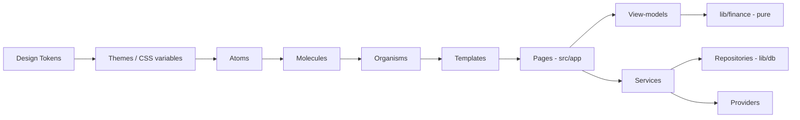

# System Architecture & Dependency Flow

WealthTrack follows a strict **Atomic Design** system and unidirectional data flow.

## Unidirectional Dependency Flow

## Atomic Design Hierarchy

1. **Tokens (`src/styles/tokens/`)**:
   - Single source of truth for all visual values (colors, typography, spacing, radius, shadows, sizes, breakpoints, z-index, motion, and finance semantics).
   - Component files never declare raw hex colors or arbitrary dimensions.

2. **Themes (`src/styles/themes/`)**:
   - Maps semantic roles to primitive tokens (`light.ts`, `dark.ts`).
   - Root layout injects them into `:root` as CSS variables via `themeToCss.ts`.

3. **Atoms (`src/components/atoms/`)**:
   - Smallest individual UI elements (`Button`, `Input`, `Select`, `Textarea`, `Checkbox`, `Label`, `Icon`, `Text`, `Heading`, `Badge`, `Avatar`, `Spinner`, `Skeleton`, `Divider`, `MoneyText`, `PercentText`, `DateText`).
   - Purely presentational; no domain calculations or data fetching.

4. **Molecules (`src/components/molecules/`)**:
   - Small functional groupings of atoms (`FormField`, `CardHeader`, `StatCard`, `Alert`, `EmptyState`, `DisclaimerNotice`, `GainLossIndicator`, `FreshnessBadge`, `AssetClassTag`, `SearchBox`, `InputGroup`, `CurrencyInput`, `Pagination`, `NavItem`, `UserInfo`, `ChartContainer`, `ConfirmDialog`, `Stepper`).

5. **Organisms (`src/components/organisms/`)**:
   - Self-contained sections grouped by domain (`layout`, `dashboard`, `transactions`, `holdings`, `fixed-income`, `real-estate`, `gains`, `accounts`, `reports`, `pricing`, `shared`).
   - Receive all data via props; no DB access.

6. **Templates (`src/components/templates/`)**:
   - Structural page layouts (`AuthLayout`, `DashboardLayout`, `PageLayout`, `ReportLayout`).

7. **Pages (`src/app/`)**:
   - Next.js App Router server components.
   - Load data from DB/services, call pure finance routines, map to view models, and compose templates and organisms.

## Financial Calculation Rules
- All money, quantity, rate, basis, and yield calculations reside exclusively in pure functions inside `src/lib/finance/`.
- `decimal.js` is used for **all** mathematical calculations. JavaScript standard floating-point numbers are strictly forbidden for financial calculations.
- Display formatting (`src/lib/format/`) turns numbers into localized strings for rendering only; formatted strings are never fed back into financial logic.
