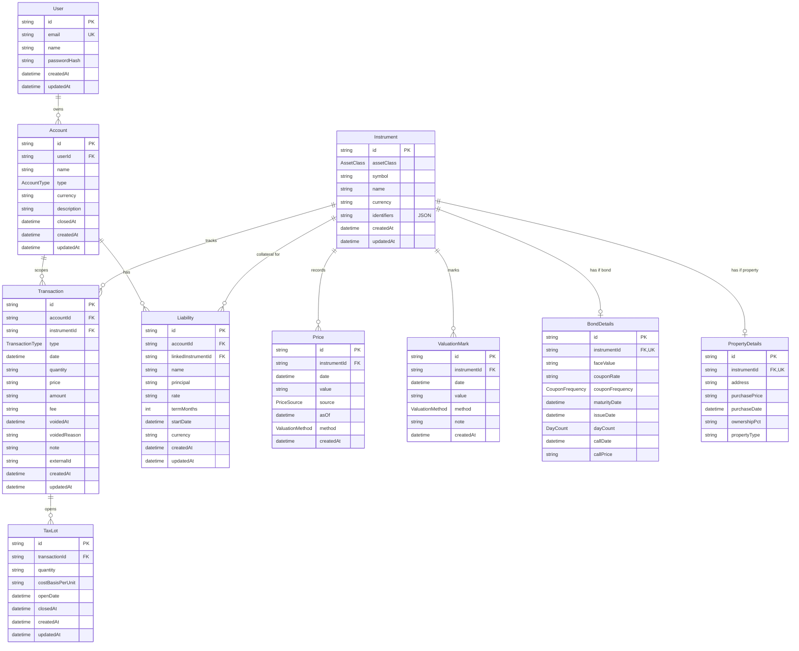

# Entity-Relationship Diagram

This diagram documents the core data models, relationships, and enums defined in `prisma/schema.prisma`.

## Immutable Ledger Architecture
- **Holdings, cash balances, and cost bases are derived**: never store editable snapshot values directly.
- **Auditable**: voiding a transaction sets `voidedAt` and `voidedReason`; it is never physically removed from the ledger.
- **Multi-Asset**: `Instrument` supports `equity`, `crypto`, `fixed_income`, `real_estate`, and `cash`. Specialized details (`BondDetails`, `PropertyDetails`) attach via 1-to-1 relations.
